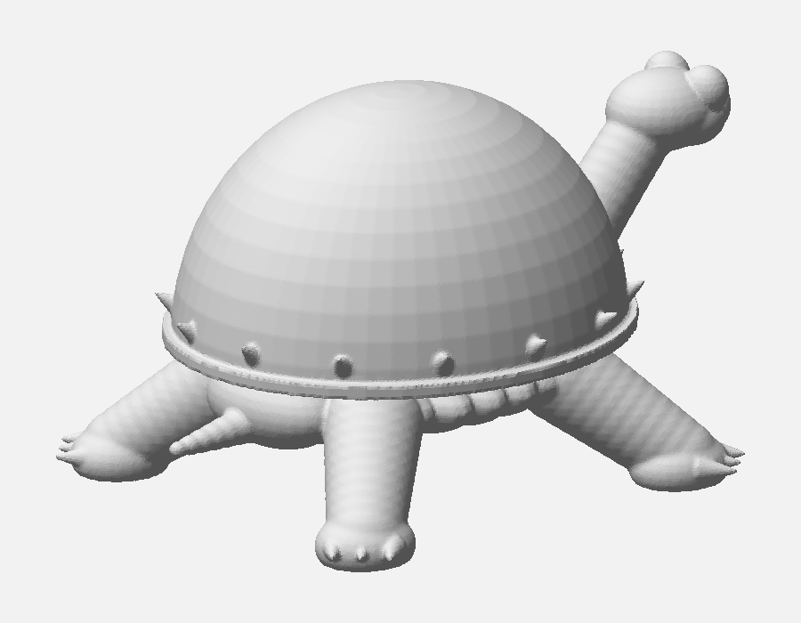

# Żółw — figurka do malowania

Postać z kreskówki, modelowana proceduralnie w Blenderze (skrypt, nie rzeźbienie
ręczne). Jeden kolor, dwie części łączone na kołki, druk bez podpór.



Model: [`cad/zolw.py`](cad/zolw.py)

## Cel

Figurka na półkę, malowana ręcznie po wydruku. Dlatego **jeden kolor** — żadnego
multicolor z AMS Lite, bo wieża czyszcząca przy takim detalu kosztowałaby więcej
filamentu niż sama figurka, a i tak wszystko idzie pod farbę.

## Proporcje — skąd się wzięły

Pierwsza wersja była robiona z opisu gatunku („żółw miękkoskorupowy = płaski")
i wyszła naleśnikiem. **Proporcje są teraz zdjęte z klatek serialu**, i to
zmieniło cztery rzeczy:

| cecha | z opisu gatunku | z klatek |
|---|---|---|
| wysokość pancerza | 0.26 długości (płaski) | **0.52 — bąbel** |
| ryjek | zwężający się stożek | **płaski dysk z dwiema dziurkami** |
| nogi | długie słupki | **krótkie, przysadziste, z dużymi pazurami** |
| rant pancerza | gładki | **kolce dookoła** |

Oczy są samymi wypukłymi gałkami. Ciężkie powieki, które postać ma na rysunku,
to kreska — łatwiej je domalować niż wydrukować, a próba zrobienia ich
geometrią dawała efekt guzika z kapeluszem.

## Skalowanie

W skrypcie jest **jedna liczba do zmiany**:

```python
PANCERZ_DL = 70.0        # dlugosc pancerza [mm]
```

Wszystkie pozostałe wymiary to ułamki tej liczby, więc zmiana przeskalowuje
całość z zachowaniem proporcji. Przy 70 mm figurka ma **104 × 75 × 58 mm**
po złożeniu. Chcesz mniejszą — wpisz 50 i uruchom skrypt ponownie.

Uwaga przy zmniejszaniu: pazury mają `0.080 × PANCERZ_DL`, więc przy 50 mm
schodzą do ~4 mm, a przy 35 mm do ~2.8 mm. Poniżej tego warto najpierw
sprawdzić, co wychodzi, testem z [`kalibracja/test-rozdzielczosci/`](../../kalibracja/test-rozdzielczosci/).

## Materiał

**PLA** — figurka wystawowa, zero obciążeń, a PLA najlepiej trzyma drobny detal
i najłatwiej się maluje (PETG trzeba odtłuścić i gorzej trzyma podkład).

## Części i druk

| część | gabaryty [mm] | orientacja | podpory |
|---|---|---|---|
| `zolw-cialo` | 104 × 75 × 52 | jak stoi, na stopach | **tak — tylko pod brzuchem** |
| `zolw-pancerz` | 72 × 66 × 36 | kopułą do góry, płaską podstawą na stół | **nie** |

### Podpory — co i dlaczego

Tułów wisi **10 mm nad płytą** na czterech nogach, więc brzuch nie ma się na
czym oprzeć. Policzone na gotowej siatce (udział powierzchni nachylonej
bardziej niż 45°, z pominięciem tego, co leży na stole):

| część | powierzchnia | zwisy | gdzie |
|---|---|---|---|
| `zolw-cialo` | 11 142 mm² | **2 143 mm²** (19 %) | spód brzucha, powyżej 8 mm |
| `zolw-pancerz` | 11 373 mm² | **31 mm²** | tylko dna gniazd na kołki |

Czyli: **pancerz drukuj bez podpór**, ciało z podporami, ale ustawionymi na
*„tylko od płyty"* — wyrosną spod brzucha, między nogami, i po oderwaniu
zostaną ślady na spodzie, którego i tak nie widać na półce.

Szyja podpór **nie** potrzebuje: wznosi się pod **52°**, a próg samonośności
to 45°. Skrypt wypisuje ten kąt przy każdym uruchomieniu — jeśli zmienisz
`SZYJA_WYSUW_F` albo `GLOWA_Z_F` i spadnie poniżej 45, spód szyi zacznie
wisieć i trzeba będzie podpierać też ją.

### Ustawienia

> Wartości startowe, nie zmierzone na moim egzemplarzu A1.

| | |
|---|---|
| Warstwa | 0.12 mm (detal głowy i pazurów) |
| Ścianki | 2 |
| Wypełnienie | 10–15 % |
| Chłodzenie | 100 % |
| Brim | niepotrzebny — obie części mają dużą stopę |
| Podpory | **tylko ciało**, tryb „od płyty" |
| Zużycie | bryła 119 cm³ → szacunkowo **45–60 g PLA** przy 15 % |

### Montaż

Pancerz wchodzi na **dwa kołki Ø4 mm** (gniazda Ø4.4, luz 0.4 na klej).
Kropla kleju i gotowe. Podział na dwie części jest też po to, żeby malować
deseń na skorupie osobno, bez obchodzenia nóg i głowy.

## Status

**Wygenerowane, nie wydrukowane.**

```
szyja: wznios 52 st. (spod samonosny gdy >= 45)
cialo     trojk=85990  nonmanifold=0  ROZLACZNYCH=1  bbox=104.0 x 75.1 x 51.8 mm  V=36.5 cm3
pancerz   trojk=41533  nonmanifold=0  ROZLACZNYCH=1  bbox=72.4 x 66.1 x 36.4 mm   V=82.3 cm3
```

`ROZLACZNYCH=1` to kontrola, która tu zarabia na siebie: **szczelność nie
oznacza spójności.** Wcześniejsza wersja miała `nonmanifold=0` i składała się
z pięciu osobnych brył — korpusu i czterech odłączonych nóg. Samo sprawdzenie
szczelności by tego nie wykryło.

## Wnioski

*(do uzupełnienia po wydruku)*

Rzeczy, które wiem, że są niedokończone:

- **Tułów pod pancerzem jest żebrowany** — widać dziewięć elipsoid, z których
  jest złożony. W złożeniu zakrywa go pancerz, więc to kosmetyka, ale gdyby
  ktoś zdjął skorupę, widać.
- **Pancerz jest gładki** — na rysunku ma delikatną kreskę wzdłuż i poprzeczne
  fałdy nad głową. Do domalowania albo do dorobienia w modelu.
- Kolce na rancie są drobne (ok. 5 mm przy `PANCERZ_DL = 70`); przy
  zmniejszaniu figurki zejdą poniżej sensownej granicy.

### Druga pułapka: co wystaje poniżej podstawy

Kolce na rancie były posadzone tak nisko i pochylone tak płasko, że schodziły
**0,76 mm poniżej płaskiego spodu pancerza** — wydruk stałby na czternastu
czubkach zamiast na podstawie. Nie widać tego na renderze ani w kontroli
szczelności; wyszło dopiero z pomiaru `zmin` gotowego STL-a. Poza podniesieniem
kolców skrypt ma teraz bezpiecznik: po remeshu ścina pancerz płaszczyzną z = 0,
więc cokolwiek by wystawało w dół, zostanie zrównane.

### Pułapka techniczna, warto zapamiętać

Boolean na siatce, która sama się przecina, jest nieokreślony. Po `join()`
pancerz był kilkunastoma przenikającymi się powłokami (kopuła + rant + kolce);
wiercenie w tym gniazd na kołki **skasowało całą kopułę** i zostawiło same
kolce. Kolejność musi być: `join → remesh → boolean`, nigdy odwrotnie.
